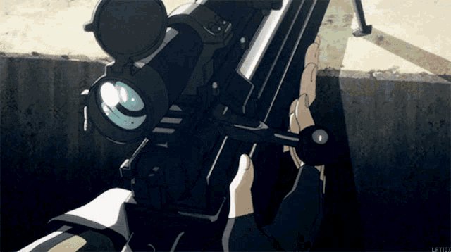

  

### Profile

<table>
<tr>
<td width="205" align="center">

</td>
<td valign="middle">
<strong>Kayro / Kayro25</strong>  
Self-taught fullstack developer. 
Web, games, CLI tools and automation.  

</td>
</tr>
</table>

### Selected projects

| Project | Description |
| :--- | :--- |
| [**autoB**](https://github.com/Kayro25/autoB) | CLI scaffolding from reusable YAML templates. |
| [**scrapCrypto**](https://github.com/Kayro25/scrapCrypto) | Galxe quest rankings and Telegram alerts. |
| [**fallDetectionSystem**](https://github.com/Kayro25/fallDetectionSystem) | Camera-based fall detection with ONNX and MQTT. |

### Contact

シノン · Phantom Bullet / SAO II · <a href="https://tenor.com/view/sinon-sao-sword-art-online-gif-25208771">GIF source</a>

