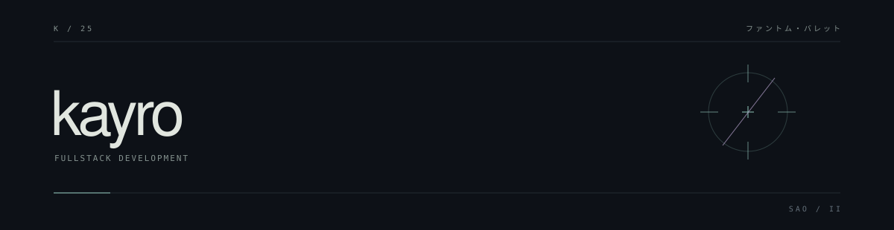

 

Self-taught developer. Web, games, CLI tools, and automation. 
Python / JavaScript / Node.js / Linux

  

SELECTED WORK

  

<a href="https://github.com/Kayro25/autoB"><strong>autoB</strong></a> 
Project scaffolding from YAML templates.

 

<a href="https://github.com/Kayro25/scrapCrypto"><strong>scrapCrypto</strong></a> 
Galxe quest ranking and Telegram alerts.

 

<a href="https://github.com/Kayro25/fallDetectionSystem"><strong>fallDetectionSystem</strong></a> 
Fall detection for IP cameras with ONNX and MQTT.

   

<a href="mailto:me0711405@gmail.com">email</a> &nbsp; / &nbsp; <a href="https://github.com/Kayro25?tab=repositories">repositories</a>

  

