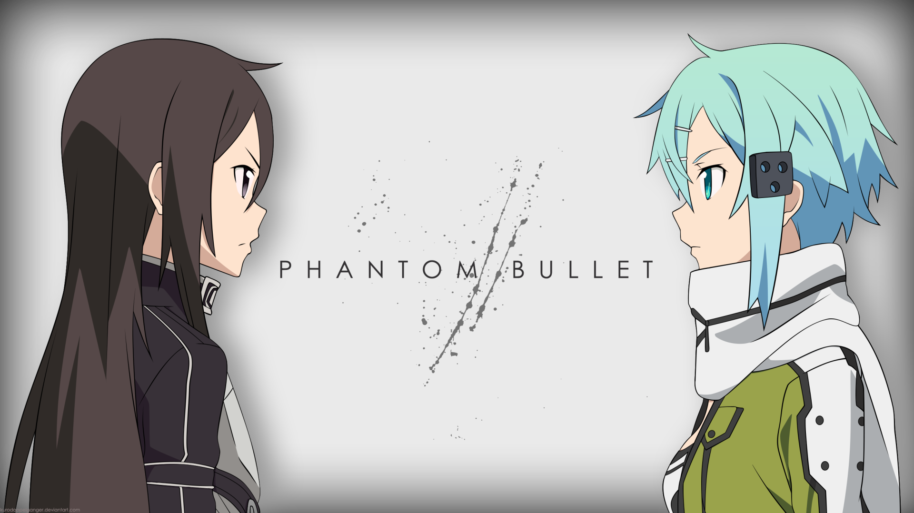

ソードアート・オンライン Ⅱ

 

 

Web &nbsp; / &nbsp; Games &nbsp; / &nbsp; CLI &nbsp; / &nbsp; Automation

  

  

SELECTED WORK

  

<a href="https://github.com/Kayro25/autoB"><strong>autoB</strong></a> &nbsp; YAML project scaffolding 
<a href="https://github.com/Kayro25/scrapCrypto"><strong>scrapCrypto</strong></a> &nbsp; Galxe rankings & Telegram alerts 
<a href="https://github.com/Kayro25/fallDetectionSystem"><strong>fallDetectionSystem</strong></a> &nbsp; ONNX & MQTT fall detection

 

<a href="mailto:me0711405@gmail.com">EMAIL</a> &nbsp; / &nbsp; <a href="https://github.com/Kayro25?tab=repositories">REPOSITORIES</a>

 

<a href="https://wall.alphacoders.com/big.php?i=791572">Artwork source</a> · Phantom Bullet

