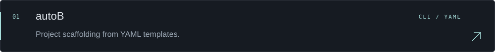
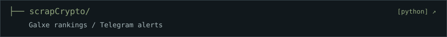
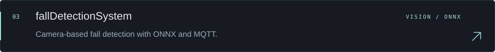

 

Web, games, CLI tools & automation.

<code>Python</code> &nbsp; <code>JavaScript</code> &nbsp; <code>Node.js</code> &nbsp; <code>Linux</code>

 

SELECTED PROJECTS &nbsp; / &nbsp; 01—03

 

  

<a href="mailto:me0711405@gmail.com">EMAIL ↗</a> &nbsp; / &nbsp; <a href="https://github.com/Kayro25?tab=repositories">REPOSITORIES ↗</a>

 

ソードアート・オンライン Ⅱ &nbsp; / &nbsp; PHANTOM BULLET 
Wallpaper signed Paul Abstract · <a href="https://wallpaper.mob.gr.jp/pc/image/anime-sword_art_online_ii-sinon_sword_art_online-407429.html">source</a>
