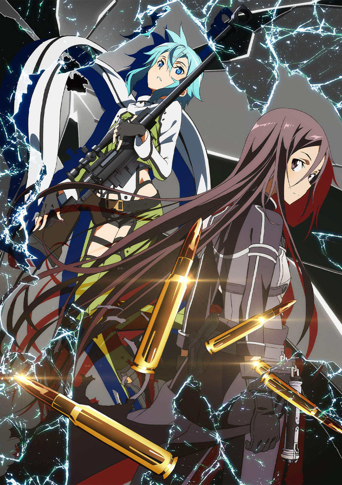

 

 

Web, games, CLI tools & automation.

<code>Python</code> <code>JavaScript</code> <code>Node.js</code> <code>Linux</code>

 

01 &nbsp; / &nbsp; <a href="https://github.com/Kayro25/autoB"><strong>autoB</strong></a> 
Project scaffolding from YAML templates.

02 &nbsp; / &nbsp; <a href="https://github.com/Kayro25/scrapCrypto"><strong>scrapCrypto</strong></a> 
Galxe quest ranking & Telegram alerts.

03 &nbsp; / &nbsp; <a href="https://github.com/Kayro25/fallDetectionSystem"><strong>fallDetectionSystem</strong></a> 
Fall detection with ONNX & MQTT.

 

<a href="mailto:me0711405@gmail.com">EMAIL ↗</a> &nbsp; / &nbsp; <a href="https://github.com/Kayro25?tab=repositories">REPOSITORIES ↗</a>

 
 

ソードアート・オンライン Ⅱ &nbsp; · &nbsp; <a href="https://www.swordart-online.net/phantom/">Art ©2014 SAOII Project</a>
