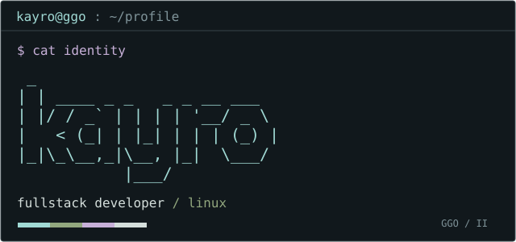

<code>Python</code> <code>JavaScript</code> <code>Node.js</code> · web / games / automation

 

<pre>~/projects
└── selected</pre>

 
 

<code>~/links</code> &nbsp; <a href="mailto:me0711405@gmail.com">email ↗</a> &nbsp; <a href="https://github.com/Kayro25?tab=repositories">repositories ↗</a>

シノン / GGO &nbsp; · &nbsp; Wallpaper: Paul Abstract · <a href="https://wallpaper.mob.gr.jp/pc/image/anime-sword_art_online_ii-sinon_sword_art_online-407429.html">source</a>
